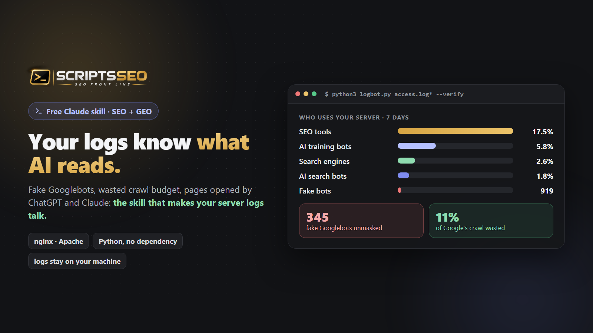

# logbot

A Claude skill that reads your server logs the way an SEO would, in the age of AI search. Give it nginx or Apache
access logs: it tells you which bots really crawl the site, which ones are fakes, where Googlebot wastes its crawl
budget, and which pages ChatGPT, Claude or Perplexity open when a user asks them a question.

Search Console only gives a summary, and nothing at all about AI crawlers. Your logs see everything.

The skill bundles a Python script (no dependency, Python 3.8 or later), a reference of the bots, and the method Claude
follows to turn the numbers into ranked actions. The script also works on its own, without Claude.



## What it does

1. **Sorts every request** into families: search engines, AI training crawlers, AI search crawlers, AI fetchers acting
   for a user, SEO tools, social previews, scripts, browsers.
2. **Unmasks fake bots**: an IP claiming to be Googlebot, Bingbot, GPTBot, OAI-SearchBot, ChatGPT-User, PerplexityBot or
   Perplexity-User is checked against the official IP lists; Apple, Yandex and Baidu are checked by forward-confirmed
   reverse DNS. Impostors are moved out of the figures.
3. **Measures Googlebot's crawl budget**: certain waste (redirects, 4xx, 5xx, tracking and session parameters), URL
   templates that take the crawl (`/topic-{n}-...html`, `/profile.php?id=*`), pages in error, crawl frequency.
4. **Crosses with the sitemap**: sitemap URLs Googlebot never fetched, URLs crawled outside the sitemap.
5. **GEO view**: what each AI family reads, and above all the pages AI assistants open on behalf of their users,
   which is the best server-side sign that a page is used as a source.
6. **Checks robots.txt** (bots fetching disallowed URLs), technical files (`llms.txt`, `.well-known`, sitemaps) and
   security probes (`/.env`, `/.git`, `wp-login.php`...), which are kept out of the page rankings.
7. **Reports**, in French: a Markdown report, plus `adresses.csv` (one row per URL, one column per bot) with `--out`.
   With the skill, Claude reads that report and writes the analysis: summary, findings, ranked actions, limits.

Logs stay with you: the script runs where the logs are, and Claude only works on the aggregated report.

## Install

**Claude Code**: clone the repository into your skills folder.

```bash
git clone https://github.com/jaffaars/claude-skills-logbot ~/.claude/skills/logbot
```

Windows PowerShell: `git clone https://github.com/jaffaars/claude-skills-logbot $HOME\.claude\skills\logbot`

Claude then uses it on its own as soon as you talk about logs, crawl, Googlebot or AI bots.

**Claude.ai**: download `logbot.zip` from the [latest release](https://github.com/jaffaars/claude-skills-logbot/releases)
and add it in the settings, skills section (code execution must be on). Then upload a log file in the conversation.
The bot check (`--verify`) needs internet access from the code sandbox; without it, the report says so.

**Without Claude**: the script is `scripts/logbot.py`.

## Usage

Ask Claude, for instance:

- "Analyse mes logs nginx des 30 derniers jours, dis-moi où part le crawl de Google."
- "Which AI bots read my site, and which ones are fake?"
- "Does ChatGPT open my pages? Which ones?"

Or run the script yourself:

```bash
python3 scripts/logbot.py /var/log/nginx/access.log* --days 30 --verify \
  --sitemap https://example.com/sitemap.xml --robots https://example.com/robots.txt --out rapport-logs
```

On a remote server, without copying the script there:

```bash
ssh my-server "python3 - /var/log/nginx/access.log* --days 30 --verify" < scripts/logbot.py
```

| Option | Role |
|---|---|
| `--days N` | keep only the last N days |
| `--verify` | unmask fake bots (official IP lists and reverse DNS); use it almost always |
| `--dns-limit N` | IPs checked by DNS for each bot without an official list (default 100) |
| `--sitemap` | URL or file of the sitemap (indexes included) |
| `--robots` | URL or file of robots.txt |
| `--top N` | length of the rankings (default 15) |
| `--out DIR` | write `rapport.md` and `adresses.csv` instead of printing the report |

300,000 log lines with `--verify` and a sitemap take about a minute and a half.

## Example

Seven days of logs from a French SEO forum (301,491 requests):

```
| Famille                                    | Requêtes | Part   |
|--------------------------------------------|---------:|-------:|
| Moteurs de recherche                       |    7 874 |  2.6 % |
| IA : index de recherche                    |    5 388 |  1.8 % |
| IA : lecture à la demande d'un utilisateur |      279 |  0.1 % |
| IA : entraînement                          |   17 532 |  5.8 % |
| Outils SEO                                 |   52 854 | 17.5 % |
| Robots usurpés (faux moteurs, fausses IA)  |      920 |  0.3 % |

- Faux Googlebot : 346 requêtes, 4xx 11.6 %
- Faux ChatGPT-User : 28 requêtes, 4xx 92.9 %
- Gaspillage certain : 11.3 % (redirections 8.4 %, 4xx 2.3 %, paramètres de pistage ou de session 0.7 %)
```

What it meant for that site: SEO tools used seven times more of the server than search engines, a few hundred fake
Googlebots were probing for `/.env` files, and the page AI assistants opened most for their users (after the home
page) was a post about the Google leak, a clear sign of which content serves as a source.

## Reading the results

The skill gives Claude a full interpretation grid. The essentials:

1. **Verify first.** Without `--verify`, every figure includes impostors.
2. **Three AI families, three decisions.** Training crawlers (GPTBot, ClaudeBot...) bring no visit. Search crawlers
   (OAI-SearchBot, PerplexityBot, Claude-SearchBot) decide whether you can be cited. On-demand fetchers (ChatGPT-User,
   Claude-User, Perplexity-User) show the pages actually used as sources. Blocking GPTBot does not stop ChatGPT from
   citing you: OAI-SearchBot does that job.
3. **Crawl waste above about 10 %** is worth fixing: internal links to redirected URLs, broken links, tracking
   parameters in internal links.
4. **Look at templates, not URLs**: if profiles, tags or sort pages take more crawl than your articles or products,
   the internal linking or the architecture needs work.

`references/robots.md` lists the bots, their robots.txt tokens, how to verify them, and robots.txt and server recipes.

## Limits

- Behind a CDN (Cloudflare...), log IPs belong to the CDN: bot checks are wrong until the server logs the real client
  IP, and cached pages never reach the origin logs.
- Anthropic, Meta, Amazon and others publish no IP list the script can use: their bots are judged by behaviour (4xx
  rate, probes).
- Take at least 30 days of logs for the crawl budget; 7 days are enough for AI bots and fake bots.
- The combined log format (nginx and Apache default) is expected. Other formats need `LINE_RE` adapted.
- Log IPs are personal data: run the script where the logs are, and share only the report.

## License

[MIT](LICENSE)
